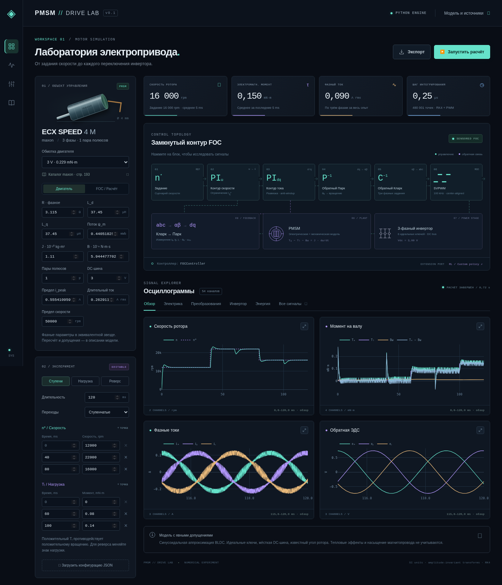

# PMSM // Drive Lab

Python-симулятор трёхфазного PMSM с переключаемым шестиключевым инвертором,
FOC и интерактивным интерфейсом в стиле sci-fi / cyberpunk. Исходные данные —
maxon ECX SPEED 4 M, обмотки 3 и 6 V, из предоставленного каталога.

**Важно для интерпретации:** в каталоге указан BLDC. Здесь реализована его
синусоидальная PMSM-аппроксимация с явно документированным пересчётом параметров.
Для подтверждения точности на реальном двигателе нужны измерения ЭДС и параметров.



## Локальный запуск одной командой

Установите Python 3.11–3.13 (рекомендуется 3.12), распакуйте архив программы
в папку с правом записи и откройте терминал. Linux/macOS:

```bash
cd pmsm-drive-lab
python3 main.py
```

Windows (PowerShell / cmd, при установленном Python):

```powershell
cd pmsm-drive-lab
py -3.12 main.py
```

Если Python запускается командой `python`, используйте `python main.py`.
Название каталога после `cd` должно совпадать с папкой, в которую распакован архив.

При первом запуске программа автоматически создаёт `.venv` рядом с `main.py`
и устанавливает закреплённые зависимости. **Для первой установки нужен интернет.**
При повторных запусках установка пропускается, если зависимости уже соответствуют
`requirements.lock`. Все расчёты выполняются на вашем компьютере; облачная среда
и аккаунт не нужны. Интерфейс открывается в вашем обычном браузере автоматически.
Локальный адрес: `http://127.0.0.1:8000`. Держите терминал открытым; остановка — **Ctrl+C**.

Дополнительные команды:

```bash
python3 main.py --port 8001       # если порт 8000 занят
python3 main.py --no-browser     # открыть адрес в браузере вручную
python3 main.py --help
```

Сервер по умолчанию доступен только на вашем компьютере. Параметр `--host`
оставлен для явной настройки доступа в локальной сети.
Первый расчёт включает JIT-компиляцию Numba и занимает дольше последующих.
Интерфейс и Plotly поставляются локально: при дальнейшей работе интернет не нужен.

Если в Linux отсутствует `venv`, установите пакет `python3-venv` для вашей версии
Python штатным пакетным менеджером. Папку `.venv` не переносите между ОС или
компьютерами: переносите исходники и запускайте `python3 main.py` заново.

### Ручная установка для разработки

Если предпочитаете управлять окружением самостоятельно, из корня проекта:

```bash
python3 -m venv .venv
source .venv/bin/activate
python -m pip install -r requirements.lock
python -m pmsm_lab --port 8000 --no-browser
```

На Windows активация окружения: `.venv\Scripts\activate`.

## Работа с моделью

1. Выберите обмотку 3/6 V или измените фазные параметры двигателя.
2. На вкладке «FOC / Расчёт» задайте полосы PI-контуров, ШИМ и разрешение.
3. Настройте моменты изменения скорости/нагрузки (ms, rpm, mN·m).
   Есть готовые сценарии ступеней, наброса нагрузки и реверса.
4. Нажмите «Запустить расчёт». При открытии выполняется стандартный опыт.
5. Нажмите на блок схемы или значок раскрытия графика. Доступны масштабирование,
   выбор сигналов через легенду, интервал 100 µs для ключей, выгрузка PNG.
6. «Экспорт» сохраняет полную сетку в CSV/NPZ и конфигурацию в JSON.
   JSON можно загрузить для повторения опыта. Изменение формы требует нового расчёта.

Это пакетный численный эксперимент: время в графиках — моделируемое время,
не поток измерений реального двигателя. Backend хранит последний успешный опыт;
при перезапуске сервера он теряется, поэтому сохраняйте нужные результаты.

## Реализовано

- Электрические ОДУ d/q, произвольные Ld/Lq, механика с J, B и нагрузкой.
- Точные PWM-фронты внутри RK4; центрированная модуляция с min/max-инжекцией.
- FOC: PI скорости, два PI тока, развязка, anti-windup, токовый и векторный
  предел напряжения. Известный угол ротора; усреднение измерений за период PWM.
- 54 сигнала: фазные/линейные напряжения, токи, ЭДС, шесть ключей, коэффициенты
  заполнения и несущая, скорость, моменты, прямые/обратные Кларк/Парк, мощности,
  энергия, электрический угол/скорость.
- Валидация конфигурации, предупреждения о режиме, полная сетка экспорта,
  сокращённые обзорные графики с сохранением экстремумов.

Не входят: тепловая модель, потери в стали, магнитное насыщение, dead-time,
неидеальные ключи, позиционный датчик с шумом, sensorless, MTPA, автоматическое
ослабление поля, готовая среда обучения RL. Не является сертифицированной
моделью производителя. Подробности и научные источники: [docs/MODEL.md](docs/MODEL.md).

## Python API и другой контроллер

```python
from pmsm_lab.config import SimulationConfig
from pmsm_lab.simulation import simulate

result = simulate(SimulationConfig())
print(result.metrics)
print(result.time, result.signals['iq'])
# simulate(config, controller=MyController())
```

Контроллер реализует `reset(motor, sample_time)` и `step(observation)`.
Он возвращает `VoltageCommand(vd, vq)` в вольтах. Пример подключения внешней
политики: [examples/rl_adapter.py](examples/rl_adapter.py). Обучения RL в нём нет.
Физическое ядро не зависит от FastAPI/UI; контракт контроллера не зависит от FOC.

Воспроизводимый запуск без браузера:

```bash
python examples/run_experiment.py --config examples/default.json --output outputs/experiment.npz
```

NPZ открывается `numpy.load(path, allow_pickle=False)`; содержит SI-массивы,
`config_json` и `metrics_json`. CSV также хранит SI, включая момент в N·m.

## Проверки

```bash
python -m pytest -q
```

Проверяются обратимость преобразований и мощность, аналитическая RL-цепь,
тождество баланса энергии с явнополюсностью, пересчёт единиц каталога, среднее
напряжение SVPWM, физические состояния инвертора, FOC при нагрузке и реверсе,
выход из насыщения, сходимость по шагу, альтернативный контроллер и HTTP/экспорт.
Численные результаты и границы проверки — [docs/VALIDATION.md](docs/VALIDATION.md).
Браузерный сценарий — `tests/browser_smoke.py` (Playwright отдельно):

```bash
python -m pip install playwright
python -m playwright install chromium
python tests/browser_smoke.py
```

Запустите сервер до браузерной проверки. При системном Chromium можно указать
`CHROMIUM_PATH=/usr/bin/chromium`. Скриншоты сохраняются в `outputs/`.

## Структура

`main.py` — локальная установка и запуск из терминала;
`config.py` — каталог/валидация; `transforms.py` — системы координат;
`plant.py` — RK4 и инвертор; `controllers.py` — FOC и расширяемый контракт;
`simulation.py` — эксперимент и сигналы; `app.py` — локальный HTTP API;
`static/` — интерфейс; `docs/` — математика и оригинальный паспорт.

Зависимости для проверенной среды закреплены в `requirements.lock`.
Веб-приложение рассчитано на локальную доверенную среду и один расчёт за раз.
Для внешнего общего доступа потребуется отдельный слой аутентификации.

## Лицензии

Код — MIT (см. LICENSE). Plotly.js 3.1.0 — MIT; исходный заголовок сохранён,
см. `static/vendor/LICENSE.plotly`. PDF © 2025 maxon, предоставлен пользователем
как источник параметров и не покрывается лицензией на код проекта.
